# Autonomous Repository Testing & RCA Report

**Analysis ID:** RUN-A7D1939D64  
**Generated:** 1795194007.9681873  
**Final assessment:** NOT READY

## 1. Executive Summary

| Metric | Value |
| --- | --- |
| Overall project health | NOT READY |
| Components analysed | 16 |
| Tests executed | 6 |
| Tests passed | 0 |
| Tests failed/errored | 6 |
| Total issues | 9 |
| Critical issues | 0 |
| High-severity issues | 9 |
| Root causes identified | 3 |
| Confirmed root causes | 3 |
| Analysis capabilities OK / failed | 10 / 0 |

## 2. Repository Analysis

- Project types: unknown
- Languages: Python, JSON
- Frameworks: not detected
- Package managers: not detected
- Test frameworks: pytest
- Entry points: not detected
- External services: not detected
- Database references: Configured database connection reference
- Files: 8, lines: 37

### Components

| Component | Type | Path | Language |
| --- | --- | --- | --- |
| __init__ | module | src/__init__.py | Python |
| config | module | src/config.py | Python |
| config:database | database | src/config.py | Python |
| config:config | config | src/config.py | Python |
| database | module | src/database.py | Python |
| connect | function | src/database.py | Python |
| database:database | database | src/database.py | Python |
| service | module | src/service.py | Python |
| initialise_service | function | src/service.py | Python |
| service:database | database | src/service.py | Python |
| test_api | test | tests/test_api.py | Python |
| test_api_startup | function | tests/test_api.py | Python |
| test_api:database | database | tests/test_api.py | Python |
| test_database | test | tests/test_database.py | Python |
| test_database_connect | function | tests/test_database.py | Python |
| test_database:database | database | tests/test_database.py | Python |

## 3. Testing Summary

| Test | Component | Status | Error |
| --- | --- | --- | --- |
| tests.test_api |  | ERROR | collection failure |
| tests.test_database |  | ERROR | collection failure |
| DYNAMIC::connect::import | src/database.py | ERROR | KeyError: 'DATABASE_URL' |
| DYNAMIC::initialise_service::import | src/service.py | ERROR | KeyError: 'DATABASE_URL' |
| DYNAMIC::test_api_startup::import | tests/test_api.py | ERROR | KeyError: 'DATABASE_URL' |
| DYNAMIC::test_database_connect::import | tests/test_database.py | ERROR | KeyError: 'DATABASE_URL' |

## 4. Issue Summary

| ID | Component | Error Type | Severity | Status | Source | Root Cause |
| --- | --- | --- | --- | --- | --- | --- |
| DET-2B8ABA5024 | src/config.py | MissingConfiguration | HIGH | Confirmed | DETERMINISTIC | MissingConfiguration |
| DEP-ADA06F60F8 | src/config.py | MissingEnvironmentVariable | HIGH | Confirmed | DETERMINISTIC | - |
| TESTF-BA65EEA9B8 | tests.test_api | ERROR | HIGH | Confirmed | TEST | ERROR |
| TESTF-D90FD22B9E | tests.test_database | ERROR | HIGH | Confirmed | TEST | - |
| DYN-EAD97C88CD | src/database.py | DynamicImportFailure | HIGH | Confirmed | DYNAMIC | - |
| DYN-D997653056 | src/service.py | DynamicImportFailure | HIGH | Confirmed | DYNAMIC | - |
| DYN-F5F440BB36 | tests/test_api.py | DynamicImportFailure | HIGH | Confirmed | DYNAMIC | - |
| DYN-826C376DB3 | tests/test_database.py | DynamicImportFailure | HIGH | Confirmed | DYNAMIC | - |
| AGT-E24583BD2B | src/config.py | CascadingFailure | HIGH | Confirmed | AGENT | - |

## 5. Detailed RCA

### RCA-82F1E37335 — MissingConfiguration in src/config.py: Required environment variable 'DATABASE_URL' is not defined
- **Issue ID:** DET-2B8ABA5024
- **Component:** src/config.py
- **File / line:** src/config.py
- **Error type:** MissingConfiguration
- **Severity:** HIGH
- **Confidence:** 0.93 (Confirmed)
- **Verified:** True
- **Symptom:** MissingConfiguration at src/config.py: Required environment variable 'DATABASE_URL' is not defined
- **Immediate cause:** Required environment variable 'DATABASE_URL' is not defined
- **Contributing factors:** src/config.py reads DATABASE_URL; No definition found in ['.env.example']; No value present in analysis environment
- **Root cause:** MissingConfiguration in src/config.py: Required environment variable 'DATABASE_URL' is not defined
- **Impact:** 1 duplicate observation(s) collapsed
- **Evidence:** EV-D0C9C796A0, EV-061FD1DC31
- **Expected behaviour:** operation completes without MissingConfiguration
- **Observed behaviour:** Required environment variable 'DATABASE_URL' is not defined

### RCA-BC7672A9D6 — ERROR in tests.test_api: tests.test_api: collection failure
- **Issue ID:** TESTF-BA65EEA9B8
- **Component:** tests.test_api
- **File / line:** tests.test_api
- **Error type:** ERROR
- **Severity:** HIGH
- **Confidence:** 0.97 (Confirmed)
- **Verified:** True
- **Symptom:** ERROR at tests.test_api: tests.test_api: collection failure
- **Immediate cause:** tests.test_api: collection failure
- **Contributing factors:** Test tests.test_api reported ERROR; collection failure; framework=pytest
- **Root cause:** ERROR in tests.test_api: tests.test_api: collection failure
- **Impact:** 1 duplicate observation(s) collapsed
- **Evidence:** EV-042A0AD9FE
- **Expected behaviour:** operation completes without ERROR
- **Observed behaviour:** tests.test_api: collection failure

### RCA-FB9E262AFD — MissingConfiguration in src/config.py: Required environment variable 'DATABASE_URL' is not defined
- **Issue ID:** DET-2B8ABA5024
- **Component:** src/config.py
- **File / line:** src/config.py
- **Error type:** MissingConfiguration
- **Severity:** HIGH
- **Confidence:** 0.99 (Confirmed)
- **Verified:** True
- **Symptom:** DynamicImportFailure at src/database.py: Dynamic probe failed to import connect: KeyError: 'DATABASE_URL'
- **Immediate cause:** Required environment variable 'DATABASE_URL' is not defined
- **Contributing factors:** DynamicImportFailure (tests/test_database.py): Dynamic probe failed to import test_database_connect: KeyError: 'DATABASE_URL'; DynamicImportFailure (src/service.py): Dynamic probe failed to import initialise_service: KeyError: 'DATABASE_URL'; DynamicImportFailure (tests/test_api.py): Dynamic probe failed to import test_api_startup: KeyError: 'DATABASE_URL'; ERROR (tests.test_api): tests.test_api: collection failure; ERROR (tests.test_database): tests.test_database: collection failure; src/config.py reads DATABASE_URL; No definition found in ['.env.example']; No value present in analysis environment
- **Root cause:** MissingConfiguration in src/config.py: Required environment variable 'DATABASE_URL' is not defined
- **Impact:** DynamicImportFailure at tests/test_database.py: Dynamic probe failed to import test_database_connect: KeyError: 'DATABASE_URL'; DynamicImportFailure at src/service.py: Dynamic probe failed to import initialise_service: KeyError: 'DATABASE_URL'; DynamicImportFailure at src/database.py: Dynamic probe failed to import connect: KeyError: 'DATABASE_URL'; DynamicImportFailure at tests/test_api.py: Dynamic probe failed to import test_api_startup: KeyError: 'DATABASE_URL'; ERROR at tests.test_api: tests.test_api: collection failure; ERROR at tests.test_database: tests.test_database: collection failure
- **Evidence:** EV-D0C9C796A0, EV-061FD1DC31, EV-A3D8CECEE5, EV-9EAE669A1D, EV-02DC263662, EV-2E091C0A70, EV-682C4EFE00, EV-1CD40264A3, EV-EDCA4CC8D7, EV-76A34D928F, EV-042A0AD9FE, EV-02B0D47CF3
- **Expected behaviour:** operation completes without MissingConfiguration
- **Observed behaviour:** Required environment variable 'DATABASE_URL' is not defined

## 6. Root Cause Graph

```mermaid
flowchart TD
  DET-2B8ABA5024["MissingConfiguration: Required environment variable 'DATABAS"]:::issue
  DEP-ADA06F60F8["MissingEnvironmentVariable: Required environment variable 'D"]:::issue
  TESTF-BA65EEA9B8["ERROR: tests.test_api: collection failure"]:::issue
  TESTF-D90FD22B9E["ERROR: tests.test_database: collection failure"]:::issue
  DYN-EAD97C88CD["DynamicImportFailure: Dynamic probe failed to import connect"]:::issue
  DYN-D997653056["DynamicImportFailure: Dynamic probe failed to import initial"]:::issue
  DYN-F5F440BB36["DynamicImportFailure: Dynamic probe failed to import test_ap"]:::issue
  DYN-826C376DB3["DynamicImportFailure: Dynamic probe failed to import test_da"]:::issue
  AGT-E24583BD2B["CascadingFailure: 6 downstream failure(s) traced to MissingC"]:::issue
  CMP-55DE0240BD["__init__ (module)"]:::component
  CMP-57414581DA["config (module)"]:::component
  CMP-3223E0D154["config:database (database)"]:::component
  CMP-CC5780D2CC["config:config (config)"]:::component
  CMP-4AB118CB1D["database (module)"]:::component
  CMP-648BBE8BFF["database:database (database)"]:::component
  CMP-B9806EC424["service (module)"]:::component
  CMP-CC5E61F06A["service:database (database)"]:::component
  CMP-D22EC8B26D["test_api:database (database)"]:::component
  CMP-FE19DC865F["test_database:database (database)"]:::component
  TEST-A10A2552AD["tests.test_api"]:::test
  TEST-9E507619CB["tests.test_database"]:::test
  DTEST-CED2AEB356["DYNAMIC::connect::import"]:::test
  DTEST-D94E8FF1A2["DYNAMIC::initialise_service::import"]:::test
  DTEST-78EE5BD1CA["DYNAMIC::test_api_startup::import"]:::test
  DTEST-542B07C06C["DYNAMIC::test_database_connect::import"]:::test
  DET-2B8ABA5024 -->|causes| DYN-826C376DB3
  DET-2B8ABA5024 -->|causes| DYN-D997653056
  DET-2B8ABA5024 -->|causes| DYN-EAD97C88CD
  DET-2B8ABA5024 -->|causes| DYN-F5F440BB36
  DET-2B8ABA5024 -->|causes| TESTF-BA65EEA9B8
  DET-2B8ABA5024 -->|causes| TESTF-D90FD22B9E
  DET-2B8ABA5024 -->|affects| CMP-57414581DA
  DEP-ADA06F60F8 -->|affects| CMP-57414581DA
  TEST-A10A2552AD -->|reproduces| TESTF-BA65EEA9B8
  TEST-9E507619CB -->|reproduces| TESTF-D90FD22B9E
  DYN-EAD97C88CD -->|affects| CMP-4AB118CB1D
  DYN-D997653056 -->|affects| CMP-B9806EC424
  AGT-E24583BD2B -->|affects| CMP-57414581DA
  classDef issue fill:#ffe0e0,stroke:#c00;
  classDef test fill:#fff3cd,stroke:#e0a800;
  classDef component fill:#d9edf7,stroke:#31708f;
```

| From | To | Relationship |
| --- | --- | --- |
| DET-2B8ABA5024 | DYN-826C376DB3 | causes |
| DET-2B8ABA5024 | DYN-D997653056 | causes |
| DET-2B8ABA5024 | DYN-EAD97C88CD | causes |
| DET-2B8ABA5024 | DYN-F5F440BB36 | causes |
| DET-2B8ABA5024 | TESTF-BA65EEA9B8 | causes |
| DET-2B8ABA5024 | TESTF-D90FD22B9E | causes |
| DET-2B8ABA5024 | CMP-57414581DA | affects |
| DEP-ADA06F60F8 | CMP-57414581DA | affects |
| TEST-A10A2552AD | TESTF-BA65EEA9B8 | reproduces |
| TEST-9E507619CB | TESTF-D90FD22B9E | reproduces |
| DYN-EAD97C88CD | CMP-4AB118CB1D | affects |
| DYN-D997653056 | CMP-B9806EC424 | affects |
| AGT-E24583BD2B | CMP-57414581DA | affects |

## 7. Missing Test Coverage

- No test observed for module '__init__' (src/__init__.py)
- No test observed for module 'config' (src/config.py)
- No test observed for database 'config:database' (src/config.py)

## 8. Recommended Fix Order

### 1. FIX-46DB95E41A (priority 10) — src/config.py
- **Problem:** Required environment variable 'DATABASE_URL' is not defined
- **Root cause:** MissingConfiguration in src/config.py: Required environment variable 'DATABASE_URL' is not defined
- **Affected component:** config.py
- **Required change:** Define 'DATABASE_URL' in the runtime environment (or .env), and make code resilient with a safe default: os.environ.get('DATABASE_URL', 'sqlite:///:memory:') instead of direct indexing.
- **Why it works:** The value is read at src/config.py but absent from all configuration sources; direct indexing raises KeyError before dependent components start.
- **Side effects:** A default can mask a real deployment misconfiguration; log a warning when used.
- **Additional changes:** Add 'DATABASE_URL=' to .env.example without a real secret.; Fail fast at startup with a clear message when running in production.
- **Verification:** Re-run original failing test with DATABASE_URL supplied; agent verification already confirmed failure count decreases when the value is provided.
- **Regression tests:** Full existing test suite, Boundary probes for the affected component
- **Verification result:** CONFIRMED — Applied replaced 'os.environ['DATABASE_URL']' in src/config.py; updated .env.example; resolved 6 failing test(s), no new failures.
- **Regression result:** 2/2 passed; 6 resolved; 0 new failures. Regression check passed.

### 2. FIX-C3C6863A98 (priority 15) — tests.test_api
- **Problem:** tests.test_api: collection failure
- **Root cause:** ERROR in tests.test_api: tests.test_api: collection failure
- **Affected component:** tests.test_api
- **Required change:** Inspect expected vs actual values in tests.test_api and correct the failing logic or test expectation.
- **Why it works:** The test is a confirmed, reproducible failure with deterministic evidence.
- **Side effects:** If the test expectation is wrong, update the test rather than production code.
- **Additional changes:** none
- **Verification:** Re-run the original failing test, then related tests.
- **Regression tests:** Full existing test suite, Boundary probes for the affected component
- **Verification result:** SKIPPED — No safe automated patch available; recommendation requires a human-reviewed change. Deterministic hypothesis verification evidence is reported in the RCA chain.
- **Regression result:** Skipped: fix not confirmed or no automatable patch

## 9. Evidence Record

| Finding | Evidence items | Confidence | Status |
| --- | --- | --- | --- |
| Required environment variable 'DATABASE_URL' is not defined | Finding DET-2B8ABA5024 (DETERMINISTIC); src/config.py reads DATABASE_URL; No definition found in ['.env.example']; No value present in analysis environment | 0.93 | Confirmed |
| Required environment variable 'DATABASE_URL' is not defined | Finding DEP-ADA06F60F8 (DETERMINISTIC); src/config.py reads DATABASE_URL; No definition found in ['.env.example']; No value present in analysis environment | 0.93 | Confirmed |
| tests.test_api: collection failure | Finding TESTF-BA65EEA9B8 (TEST); Test tests.test_api reported ERROR; collection failure; framework=pytest | 0.97 | Confirmed |
| tests.test_database: collection failure | Finding TESTF-D90FD22B9E (TEST); Test tests.test_database reported ERROR; collection failure; framework=pytest | 0.97 | Confirmed |
| Dynamic probe failed to import connect: KeyError: 'DATABASE_URL' | Finding DYN-EAD97C88CD (DYNAMIC); Generated probe import failed for connect; KeyError: 'DATABASE_URL'; Executed in isolated sandbox copy | 0.95 | Confirmed |
| Dynamic probe failed to import initialise_service: KeyError: 'DATABASE_URL' | Finding DYN-D997653056 (DYNAMIC); Generated probe import failed for initialise_service; KeyError: 'DATABASE_URL'; Executed in isolated sandbox copy | 0.95 | Confirmed |
| Dynamic probe failed to import test_api_startup: KeyError: 'DATABASE_URL' | Finding DYN-F5F440BB36 (DYNAMIC); Generated probe import failed for test_api_startup; KeyError: 'DATABASE_URL'; Executed in isolated sandbox copy | 0.95 | Confirmed |
| Dynamic probe failed to import test_database_connect: KeyError: 'DATABASE_URL' | Finding DYN-826C376DB3 (DYNAMIC); Generated probe import failed for test_database_connect; KeyError: 'DATABASE_URL'; Executed in isolated sandbox copy | 0.95 | Confirmed |
| DynamicImportFailure at src/database.py is a likely root cause: Dynamic probe failed to im | Finding DYN-EAD97C88CD: Dynamic probe failed to import connect: KeyError: 'DATABASE_URL'; Generated probe import failed for connect; KeyError: 'DATABASE_URL'; Executed in isolated  | 0.95 | Confirmed |
| DynamicImportFailure at src/service.py is a likely root cause: Dynamic probe failed to imp | Finding DYN-D997653056: Dynamic probe failed to import initialise_service: KeyError: 'DATABASE_URL'; Generated probe import failed for initialise_service; KeyError: 'DATABASE_URL'; | 0.95 | Confirmed |
| DynamicImportFailure at tests/test_api.py is a likely root cause: Dynamic probe failed to  | Finding DYN-F5F440BB36: Dynamic probe failed to import test_api_startup: KeyError: 'DATABASE_URL'; Generated probe import failed for test_api_startup; KeyError: 'DATABASE_URL'; Exe | 0.95 | Confirmed |
| DynamicImportFailure at tests/test_database.py is a likely root cause: Dynamic probe faile | Finding DYN-826C376DB3: Dynamic probe failed to import test_database_connect: KeyError: 'DATABASE_URL'; Generated probe import failed for test_database_connect; KeyError: 'DATABASE | 0.95 | Confirmed |
| MissingConfiguration at src/config.py is a likely root cause: Required environment variabl | Finding DET-2B8ABA5024: Required environment variable 'DATABASE_URL' is not defined; src/config.py reads DATABASE_URL; No definition found in ['.env.example']; No value present in  | 0.97 | Confirmed |
| MissingEnvironmentVariable at src/config.py is a likely root cause: Required environment v | Finding DEP-ADA06F60F8: Required environment variable 'DATABASE_URL' is not defined; src/config.py reads DATABASE_URL; No definition found in ['.env.example']; No value present in  | 0.93 | Confirmed |

## 10. Capability Status

| Capability | Status | Detail |
| --- | --- | --- |
| repository_understanding | OK |  |
| static_analysis | OK |  |
| dependency_analysis | OK |  |
| test_execution | OK |  |
| dynamic_analysis | OK |  |
| evidence_aggregation | OK |  |
| agent_investigation | OK |  |
| rca_and_correlation | OK |  |
| graph_and_fixes | OK |  |
| verification | OK |  |

## 11. Final Assessment

**NOT READY** — 
confirmed failures or high-severity root causes remain unresolved. Apply fixes in priority order and re-run the analysis.

*All code execution was performed in an isolated sandbox copy. Secret-like values are redacted.*
