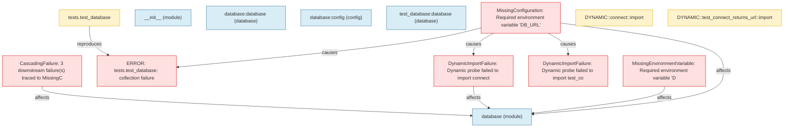

# Autonomous Repository Testing & RCA Report

**Analysis ID:** RUN-A7DF35399B  
**Generated:** 1795194012.294758  
**Final assessment:** NOT READY

## 1. Executive Summary

| Metric | Value |
| --- | --- |
| Overall project health | NOT READY |
| Components analysed | 8 |
| Tests executed | 3 |
| Tests passed | 0 |
| Tests failed/errored | 3 |
| Total issues | 6 |
| Critical issues | 0 |
| High-severity issues | 6 |
| Root causes identified | 2 |
| Confirmed root causes | 2 |
| Analysis capabilities OK / failed | 10 / 0 |

## 2. Repository Analysis

- Project types: unknown
- Languages: Python, JSON
- Frameworks: not detected
- Package managers: not detected
- Test frameworks: pytest
- Entry points: not detected
- External services: not detected
- Database references: Configured database connection reference
- Files: 5, lines: 26

### Components

| Component | Type | Path | Language |
| --- | --- | --- | --- |
| __init__ | module | src/__init__.py | Python |
| database | module | src/database.py | Python |
| connect | function | src/database.py | Python |
| database:database | database | src/database.py | Python |
| database:config | config | src/database.py | Python |
| test_database | test | tests/test_database.py | Python |
| test_connect_returns_url | function | tests/test_database.py | Python |
| test_database:database | database | tests/test_database.py | Python |

## 3. Testing Summary

| Test | Component | Status | Error |
| --- | --- | --- | --- |
| tests.test_database |  | ERROR | collection failure |
| DYNAMIC::connect::import | src/database.py | ERROR | KeyError: 'DB_URL' |
| DYNAMIC::test_connect_returns_url::import | tests/test_database.py | ERROR | KeyError: 'DB_URL' |

## 4. Issue Summary

| ID | Component | Error Type | Severity | Status | Source | Root Cause |
| --- | --- | --- | --- | --- | --- | --- |
| DET-7138CDE94C | src/database.py | MissingConfiguration | HIGH | Confirmed | DETERMINISTIC | MissingConfiguration |
| DEP-9ACB37E035 | src/database.py | MissingEnvironmentVariable | HIGH | Confirmed | DETERMINISTIC | - |
| TESTF-9889314A16 | tests.test_database | ERROR | HIGH | Confirmed | TEST | - |
| DYN-EC311B32B1 | src/database.py | DynamicImportFailure | HIGH | Confirmed | DYNAMIC | - |
| DYN-17DCDED969 | tests/test_database.py | DynamicImportFailure | HIGH | Confirmed | DYNAMIC | - |
| AGT-21B8C5E029 | src/database.py | CascadingFailure | HIGH | Confirmed | AGENT | - |

## 5. Detailed RCA

### RCA-FC97E6EF0A — MissingConfiguration in src/database.py: Required environment variable 'DB_URL' is not defined
- **Issue ID:** DET-7138CDE94C
- **Component:** src/database.py
- **File / line:** src/database.py
- **Error type:** MissingConfiguration
- **Severity:** HIGH
- **Confidence:** 0.93 (Confirmed)
- **Verified:** True
- **Symptom:** MissingConfiguration at src/database.py: Required environment variable 'DB_URL' is not defined
- **Immediate cause:** Required environment variable 'DB_URL' is not defined
- **Contributing factors:** src/database.py reads DB_URL; No definition found in ['.env.example']; No value present in analysis environment
- **Root cause:** MissingConfiguration in src/database.py: Required environment variable 'DB_URL' is not defined
- **Impact:** 1 duplicate observation(s) collapsed
- **Evidence:** EV-79D490400F, EV-1494D154F6
- **Expected behaviour:** operation completes without MissingConfiguration
- **Observed behaviour:** Required environment variable 'DB_URL' is not defined

### RCA-69D8E6B99E — MissingConfiguration in src/database.py: Required environment variable 'DB_URL' is not defined
- **Issue ID:** DET-7138CDE94C
- **Component:** src/database.py
- **File / line:** src/database.py
- **Error type:** MissingConfiguration
- **Severity:** HIGH
- **Confidence:** 0.99 (Confirmed)
- **Verified:** True
- **Symptom:** DynamicImportFailure at src/database.py: Dynamic probe failed to import connect: KeyError: 'DB_URL'
- **Immediate cause:** Required environment variable 'DB_URL' is not defined
- **Contributing factors:** DynamicImportFailure (tests/test_database.py): Dynamic probe failed to import test_connect_returns_url: KeyError: 'DB_URL'; ERROR (tests.test_database): tests.test_database: collection failure; src/database.py reads DB_URL; No definition found in ['.env.example']; No value present in analysis environment
- **Root cause:** MissingConfiguration in src/database.py: Required environment variable 'DB_URL' is not defined
- **Impact:** DynamicImportFailure at tests/test_database.py: Dynamic probe failed to import test_connect_returns_url: KeyError: 'DB_URL'; DynamicImportFailure at src/database.py: Dynamic probe failed to import connect: KeyError: 'DB_URL'; ERROR at tests.test_database: tests.test_database: collection failure
- **Evidence:** EV-79D490400F, EV-1494D154F6, EV-AFF1386EB6, EV-BDFC759C17, EV-0EA5AAD65B, EV-1A85369287, EV-D009B2EAD7
- **Expected behaviour:** operation completes without MissingConfiguration
- **Observed behaviour:** Required environment variable 'DB_URL' is not defined

## 6. Root Cause Graph

| From | To | Relationship |
| --- | --- | --- |
| DET-7138CDE94C | DYN-17DCDED969 | causes |
| DET-7138CDE94C | DYN-EC311B32B1 | causes |
| DET-7138CDE94C | TESTF-9889314A16 | causes |
| DET-7138CDE94C | CMP-EF4CF851E5 | affects |
| DEP-9ACB37E035 | CMP-EF4CF851E5 | affects |
| TEST-6485B36489 | TESTF-9889314A16 | reproduces |
| DYN-EC311B32B1 | CMP-EF4CF851E5 | affects |
| AGT-21B8C5E029 | CMP-EF4CF851E5 | affects |

## 7. Missing Test Coverage

- No test observed for module '__init__' (src/__init__.py)

## 8. Recommended Fix Order

### 1. FIX-A61150417C (priority 12) — src/database.py
- **Problem:** Required environment variable 'DB_URL' is not defined
- **Root cause:** MissingConfiguration in src/database.py: Required environment variable 'DB_URL' is not defined
- **Affected component:** database.py
- **Required change:** Define 'DB_URL' in the runtime environment (or .env), and make code resilient with a safe default: os.environ.get('DB_URL', 'sqlite:///:memory:') instead of direct indexing.
- **Why it works:** The value is read at src/database.py but absent from all configuration sources; direct indexing raises KeyError before dependent components start.
- **Side effects:** A default can mask a real deployment misconfiguration; log a warning when used.
- **Additional changes:** Add 'DB_URL=' to .env.example without a real secret.; Fail fast at startup with a clear message when running in production.
- **Verification:** Re-run original failing test with DB_URL supplied; agent verification already confirmed failure count decreases when the value is provided.
- **Regression tests:** Full existing test suite, Boundary probes for the affected component
- **Verification result:** REJECTED — Applied replaced 'os.environ['DB_URL']' in src/database.py; updated .env.example; resolved=['DYNAMIC::connect::import', 'DYNAMIC::test_connect_returns_url::import', 'tests.test_database'], new_failures=['tests.test_database::test_connect_returns_url']
- **Regression result:** Skipped: fix not confirmed or no automatable patch

## 9. Evidence Record

| Finding | Evidence items | Confidence | Status |
| --- | --- | --- | --- |
| Required environment variable 'DB_URL' is not defined | Finding DET-7138CDE94C (DETERMINISTIC); src/database.py reads DB_URL; No definition found in ['.env.example']; No value present in analysis environment | 0.93 | Confirmed |
| Required environment variable 'DB_URL' is not defined | Finding DEP-9ACB37E035 (DETERMINISTIC); src/database.py reads DB_URL; No definition found in ['.env.example']; No value present in analysis environment | 0.93 | Confirmed |
| tests.test_database: collection failure | Finding TESTF-9889314A16 (TEST); Test tests.test_database reported ERROR; collection failure; framework=pytest | 0.97 | Confirmed |
| Dynamic probe failed to import connect: KeyError: 'DB_URL' | Finding DYN-EC311B32B1 (DYNAMIC); Generated probe import failed for connect; KeyError: 'DB_URL'; Executed in isolated sandbox copy | 0.95 | Confirmed |
| Dynamic probe failed to import test_connect_returns_url: KeyError: 'DB_URL' | Finding DYN-17DCDED969 (DYNAMIC); Generated probe import failed for test_connect_returns_url; KeyError: 'DB_URL'; Executed in isolated sandbox copy | 0.95 | Confirmed |
| DynamicImportFailure at src/database.py is a likely root cause: Dynamic probe failed to im | Finding DYN-EC311B32B1: Dynamic probe failed to import connect: KeyError: 'DB_URL'; Generated probe import failed for connect; KeyError: 'DB_URL'; Executed in isolated sandbox copy | 0.95 | Confirmed |
| DynamicImportFailure at tests/test_database.py is a likely root cause: Dynamic probe faile | Finding DYN-17DCDED969: Dynamic probe failed to import test_connect_returns_url: KeyError: 'DB_URL'; Generated probe import failed for test_connect_returns_url; KeyError: 'DB_URL'; | 0.95 | Confirmed |
| MissingConfiguration at src/database.py is a likely root cause: Required environment varia | Finding DET-7138CDE94C: Required environment variable 'DB_URL' is not defined; src/database.py reads DB_URL; No definition found in ['.env.example']; No value present in analysis e | 0.97 | Confirmed |
| MissingEnvironmentVariable at src/database.py is a likely root cause: Required environment | Finding DEP-9ACB37E035: Required environment variable 'DB_URL' is not defined; src/database.py reads DB_URL; No definition found in ['.env.example']; No value present in analysis e | 0.93 | Confirmed |

## 10. Capability Status

| Capability | Status | Detail |
| --- | --- | --- |
| repository_understanding | OK |  |
| static_analysis | OK |  |
| dependency_analysis | OK |  |
| test_execution | OK |  |
| dynamic_analysis | OK |  |
| evidence_aggregation | OK |  |
| agent_investigation | OK |  |
| rca_and_correlation | OK |  |
| graph_and_fixes | OK |  |
| verification | OK |  |

## 11. Final Assessment

**NOT READY** — 
confirmed failures or high-severity root causes remain unresolved. Apply fixes in priority order and re-run the analysis.

*All code execution was performed in an isolated sandbox copy. Secret-like values are redacted.*
