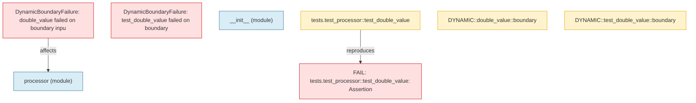

# Autonomous Repository Testing & RCA Report

**Analysis ID:** RUN-5001E7A26A  
**Generated:** 1795194014.0442784  
**Final assessment:** NOT READY

## 1. Executive Summary

| Metric | Value |
| --- | --- |
| Overall project health | NOT READY |
| Components analysed | 5 |
| Tests executed | 3 |
| Tests passed | 0 |
| Tests failed/errored | 3 |
| Total issues | 3 |
| Critical issues | 0 |
| High-severity issues | 1 |
| Root causes identified | 3 |
| Confirmed root causes | 3 |
| Analysis capabilities OK / failed | 10 / 0 |

## 2. Repository Analysis

- Project types: unknown
- Languages: Python, JSON
- Frameworks: not detected
- Package managers: not detected
- Test frameworks: pytest
- Entry points: not detected
- External services: not detected
- Database references: not detected
- Files: 4, lines: 23

### Components

| Component | Type | Path | Language |
| --- | --- | --- | --- |
| __init__ | module | src/__init__.py | Python |
| processor | module | src/processor.py | Python |
| double_value | function | src/processor.py | Python |
| test_processor | test | tests/test_processor.py | Python |
| test_double_value | function | tests/test_processor.py | Python |

## 3. Testing Summary

| Test | Component | Status | Error |
| --- | --- | --- | --- |
| tests.test_processor::test_double_value | tests | FAIL | AssertionError: assert '55' == 10  +  where '55' = double_value({'value': '5'}) |
| DYNAMIC::double_value::boundary | src/processor.py | FAIL | empty_str -> TypeError: string indices must be integers, not 'str'; zero -> TypeError: 'int' object is not subscriptable; negative -> TypeError: 'int' object is |
| DYNAMIC::test_double_value::boundary | tests/test_processor.py | FAIL | empty_str -> AssertionError: ; zero -> AssertionError: ; negative -> AssertionError: ; empty_list -> AssertionError: ; empty_dict -> AssertionError: ; none -> A |

## 4. Issue Summary

| ID | Component | Error Type | Severity | Status | Source | Root Cause |
| --- | --- | --- | --- | --- | --- | --- |
| TESTF-85C063A9BE | tests | FAIL | HIGH | Confirmed | TEST | FAIL |
| DYN-0DCA920C61 | src/processor.py | DynamicBoundaryFailure | MEDIUM | Confirmed | DYNAMIC | DynamicBoundaryFailure |
| DYN-ED068D3417 | tests/test_processor.py | DynamicBoundaryFailure | MEDIUM | Confirmed | DYNAMIC | DynamicBoundaryFailure |

## 5. Detailed RCA

### RCA-0B80CBEDA0 — FAIL in tests: tests.test_processor::test_double_value: AssertionError: assert '55' == 10
 +  where '55' = double_value(
- **Issue ID:** TESTF-85C063A9BE
- **Component:** tests
- **File / line:** tests
- **Error type:** FAIL
- **Severity:** HIGH
- **Confidence:** 0.97 (Confirmed)
- **Verified:** True
- **Symptom:** FAIL at tests: tests.test_processor::test_double_value: AssertionError: assert '55' == 10
 +  where '55' = double_value({'value': '5'})
- **Immediate cause:** tests.test_processor::test_double_value: AssertionError: assert '55' == 10
 +  where '55' = double_value({'value': '5'})
- **Contributing factors:** Test tests.test_processor::test_double_value reported FAIL; AssertionError: assert '55' == 10
 +  where '55' = double_value({'value': '5'}); framework=pytest
- **Root cause:** FAIL in tests: tests.test_processor::test_double_value: AssertionError: assert '55' == 10
 +  where '55' = double_value({'value': '5'})
- **Impact:** none recorded
- **Evidence:** EV-E24287FB11
- **Expected behaviour:** operation completes without FAIL
- **Observed behaviour:** tests.test_processor::test_double_value: AssertionError: assert '55' == 10
 +  where '55' = double_value({'value': '5'})

### RCA-4A26DAF74B — DynamicBoundaryFailure in src/processor.py: double_value failed on boundary inputs: empty_str -> TypeError: string indic
- **Issue ID:** DYN-0DCA920C61
- **Component:** src/processor.py
- **File / line:** src/processor.py
- **Error type:** DynamicBoundaryFailure
- **Severity:** MEDIUM
- **Confidence:** 0.85 (Confirmed)
- **Verified:** True
- **Symptom:** DynamicBoundaryFailure at src/processor.py: double_value failed on boundary inputs: empty_str -> TypeError: string indices must be integers, not 'str'; zero -> TypeError: 'int' object is not subscriptable; negative -> TypeEr
- **Immediate cause:** double_value failed on boundary inputs: empty_str -> TypeError: string indices must be integers, not 'str'; zero -> TypeError: 'int' object is not subscriptable; negative -> TypeError: 'int' object is not subscriptable; 
- **Contributing factors:** Generated probe called double_value with 6 boundary inputs; 6 input(s) raised exceptions; Executed in isolated sandbox copy
- **Root cause:** DynamicBoundaryFailure in src/processor.py: double_value failed on boundary inputs: empty_str -> TypeError: string indices must be integers, not 'str'; zero -> TypeError: 'int' object is not subscriptable; negative -> TypeError: 'int' object is not subscriptable; 
- **Impact:** none recorded
- **Evidence:** EV-F4889C128A
- **Expected behaviour:** operation completes without DynamicBoundaryFailure
- **Observed behaviour:** double_value failed on boundary inputs: empty_str -> TypeError: string indices must be integers, not 'str'; zero -> TypeError: 'int' object is not subscriptable; negative -> TypeError: 'int' object is not subscriptable; 

### RCA-5BAE2C9887 — DynamicBoundaryFailure in tests/test_processor.py: test_double_value failed on boundary inputs: empty_str -> AssertionEr
- **Issue ID:** DYN-ED068D3417
- **Component:** tests/test_processor.py
- **File / line:** tests/test_processor.py
- **Error type:** DynamicBoundaryFailure
- **Severity:** MEDIUM
- **Confidence:** 0.85 (Confirmed)
- **Verified:** True
- **Symptom:** DynamicBoundaryFailure at tests/test_processor.py: test_double_value failed on boundary inputs: empty_str -> AssertionError: ; zero -> AssertionError: ; negative -> AssertionError: ; empty_list -> AssertionError: ; empty_dict -> As
- **Immediate cause:** test_double_value failed on boundary inputs: empty_str -> AssertionError: ; zero -> AssertionError: ; negative -> AssertionError: ; empty_list -> AssertionError: ; empty_dict -> AssertionError: ; none -> AssertionError: 
- **Contributing factors:** Generated probe called test_double_value with 6 boundary inputs; 6 input(s) raised exceptions; Executed in isolated sandbox copy
- **Root cause:** DynamicBoundaryFailure in tests/test_processor.py: test_double_value failed on boundary inputs: empty_str -> AssertionError: ; zero -> AssertionError: ; negative -> AssertionError: ; empty_list -> AssertionError: ; empty_dict -> AssertionError: ; none -> AssertionError: 
- **Impact:** none recorded
- **Evidence:** EV-FAC7F2D218
- **Expected behaviour:** operation completes without DynamicBoundaryFailure
- **Observed behaviour:** test_double_value failed on boundary inputs: empty_str -> AssertionError: ; zero -> AssertionError: ; negative -> AssertionError: ; empty_list -> AssertionError: ; empty_dict -> AssertionError: ; none -> AssertionError: 

## 6. Root Cause Graph

| From | To | Relationship |
| --- | --- | --- |
| TEST-6648A5DDFF | TESTF-85C063A9BE | reproduces |
| DYN-0DCA920C61 | CMP-45F8F76BB6 | affects |

## 7. Missing Test Coverage

- No test observed for module '__init__' (src/__init__.py)

## 8. Recommended Fix Order

### 1. FIX-E8587A94C3 (priority 15) — tests
- **Problem:** tests.test_processor::test_double_value: AssertionError: assert '55' == 10
 +  where '55' = double_value({'value': '5'})
- **Root cause:** FAIL in tests: tests.test_processor::test_double_value: AssertionError: assert '55' == 10
 +  where '55' = double_value({'value': '5'})
- **Affected component:** tests
- **Required change:** Inspect expected vs actual values in tests and correct the failing logic or test expectation.
- **Why it works:** The test is a confirmed, reproducible failure with deterministic evidence.
- **Side effects:** If the test expectation is wrong, update the test rather than production code.
- **Additional changes:** none
- **Verification:** Re-run the original failing test, then related tests.
- **Regression tests:** Full existing test suite, Boundary probes for the affected component
- **Verification result:** SKIPPED — No safe automated patch available; recommendation requires a human-reviewed change. Deterministic hypothesis verification evidence is reported in the RCA chain.
- **Regression result:** Skipped: fix not confirmed or no automatable patch

### 2. FIX-2851E33C71 (priority 25) — src/processor.py
- **Problem:** double_value failed on boundary inputs: empty_str -> TypeError: string indices must be integers, not 'str'; zero -> TypeError: 'int' object is not subscriptable; negative -> TypeError: 'int' object is not subscriptable; 
- **Root cause:** DynamicBoundaryFailure in src/processor.py: double_value failed on boundary inputs: empty_str -> TypeError: string indices must be integers, not 'str'; zero -> TypeError: 'int' object is not subscriptable; negative -> TypeError: 'int' object is not subscriptable; 
- **Affected component:** processor.py
- **Required change:** Add input validation/guards in src/processor.py for the failing boundary inputs.
- **Why it works:** The component raises unhandled exceptions for empty/null/negative inputs, which propagates to callers.
- **Side effects:** Stricter validation may reject previously tolerated inputs; document contract changes.
- **Additional changes:** none
- **Verification:** Re-run generated boundary probe and existing tests.
- **Regression tests:** Full existing test suite, Boundary probes for the affected component
- **Verification result:** SKIPPED — No safe automated patch available; recommendation requires a human-reviewed change. Deterministic hypothesis verification evidence is reported in the RCA chain.
- **Regression result:** Skipped: fix not confirmed or no automatable patch

### 3. FIX-8A4620DC82 (priority 25) — tests/test_processor.py
- **Problem:** test_double_value failed on boundary inputs: empty_str -> AssertionError: ; zero -> AssertionError: ; negative -> AssertionError: ; empty_list -> AssertionError: ; empty_dict -> AssertionError: ; none -> AssertionError: 
- **Root cause:** DynamicBoundaryFailure in tests/test_processor.py: test_double_value failed on boundary inputs: empty_str -> AssertionError: ; zero -> AssertionError: ; negative -> AssertionError: ; empty_list -> AssertionError: ; empty_dict -> AssertionError: ; none -> AssertionError: 
- **Affected component:** test_processor.py
- **Required change:** Add input validation/guards in tests/test_processor.py for the failing boundary inputs.
- **Why it works:** The component raises unhandled exceptions for empty/null/negative inputs, which propagates to callers.
- **Side effects:** Stricter validation may reject previously tolerated inputs; document contract changes.
- **Additional changes:** none
- **Verification:** Re-run generated boundary probe and existing tests.
- **Regression tests:** Full existing test suite, Boundary probes for the affected component
- **Verification result:** SKIPPED — No safe automated patch available; recommendation requires a human-reviewed change. Deterministic hypothesis verification evidence is reported in the RCA chain.
- **Regression result:** Skipped: fix not confirmed or no automatable patch

## 9. Evidence Record

| Finding | Evidence items | Confidence | Status |
| --- | --- | --- | --- |
| tests.test_processor::test_double_value: AssertionError: assert '55' == 10  +  where '55'  | Finding TESTF-85C063A9BE (TEST); Test tests.test_processor::test_double_value reported FAIL; AssertionError: assert '55' == 10  +  where '55' = double_value({'value': '5'}); framew | 0.97 | Confirmed |
| double_value failed on boundary inputs: empty_str -> TypeError: string indices must be int | Finding DYN-0DCA920C61 (DYNAMIC); Generated probe called double_value with 6 boundary inputs; 6 input(s) raised exceptions; Executed in isolated sandbox copy | 0.85 | Confirmed |
| test_double_value failed on boundary inputs: empty_str -> AssertionError: ; zero -> Assert | Finding DYN-ED068D3417 (DYNAMIC); Generated probe called test_double_value with 6 boundary inputs; 6 input(s) raised exceptions; Executed in isolated sandbox copy | 0.85 | Confirmed |

## 10. Capability Status

| Capability | Status | Detail |
| --- | --- | --- |
| repository_understanding | OK |  |
| static_analysis | OK |  |
| dependency_analysis | OK |  |
| test_execution | OK |  |
| dynamic_analysis | OK |  |
| evidence_aggregation | OK |  |
| agent_investigation | OK |  |
| rca_and_correlation | OK |  |
| graph_and_fixes | OK |  |
| verification | OK |  |

## 11. Final Assessment

**NOT READY** — 
confirmed failures or high-severity root causes remain unresolved. Apply fixes in priority order and re-run the analysis.

*All code execution was performed in an isolated sandbox copy. Secret-like values are redacted.*
