# Autonomous Repository Testing & RCA Report

**Analysis ID:** RUN-0AE6A723FF  
**Generated:** 1795194023.7454844  
**Final assessment:** NOT READY

## 1. Executive Summary

| Metric | Value |
| --- | --- |
| Overall project health | NOT READY |
| Components analysed | 9 |
| Tests executed | 4 |
| Tests passed | 0 |
| Tests failed/errored | 4 |
| Total issues | 4 |
| Critical issues | 0 |
| High-severity issues | 1 |
| Root causes identified | 4 |
| Confirmed root causes | 4 |
| Analysis capabilities OK / failed | 10 / 0 |

## 2. Repository Analysis

- Project types: unknown
- Languages: Python, JSON
- Frameworks: not detected
- Package managers: not detected
- Test frameworks: pytest
- Entry points: not detected
- External services: not detected
- Database references: not detected
- Files: 5, lines: 28

### Components

| Component | Type | Path | Language |
| --- | --- | --- | --- |
| __init__ | module | src/__init__.py | Python |
| database | module | src/database.py | Python |
| fetch_user | function | src/database.py | Python |
| database:database | database | src/database.py | Python |
| service | module | src/service.py | Python |
| get_user | function | src/service.py | Python |
| service:database | database | src/service.py | Python |
| test_service | test | tests/test_service.py | Python |
| test_get_user | function | tests/test_service.py | Python |

## 3. Testing Summary

| Test | Component | Status | Error |
| --- | --- | --- | --- |
| tests.test_service::test_get_user | tests | FAIL | ConnectionError: invalid DSN: user_store |
| DYNAMIC::fetch_user::boundary | src/database.py | FAIL | empty_str -> ConnectionError: invalid DSN: user_store; zero -> ConnectionError: invalid DSN: user_store; negative -> ConnectionError: invalid DSN: user_store; e |
| DYNAMIC::get_user::boundary | src/service.py | FAIL | empty_str -> ConnectionError: invalid DSN: user_store; zero -> ConnectionError: invalid DSN: user_store; negative -> ConnectionError: invalid DSN: user_store; e |
| DYNAMIC::test_get_user::boundary | tests/test_service.py | FAIL | empty_str -> ConnectionError: invalid DSN: user_store; zero -> ConnectionError: invalid DSN: user_store; negative -> ConnectionError: invalid DSN: user_store; e |

## 4. Issue Summary

| ID | Component | Error Type | Severity | Status | Source | Root Cause |
| --- | --- | --- | --- | --- | --- | --- |
| TESTF-1F30BC71F2 | tests | FAIL | HIGH | Confirmed | TEST | FAIL |
| DYN-46D3C60CB0 | src/database.py | DynamicBoundaryFailure | MEDIUM | Confirmed | DYNAMIC | DynamicBoundaryFailure |
| DYN-1A3D6976A9 | src/service.py | DynamicBoundaryFailure | MEDIUM | Confirmed | DYNAMIC | DynamicBoundaryFailure |
| DYN-07695993B3 | tests/test_service.py | DynamicBoundaryFailure | MEDIUM | Confirmed | DYNAMIC | DynamicBoundaryFailure |

## 5. Detailed RCA

### RCA-FA30ACDEB5 — FAIL in tests: tests.test_service::test_get_user: ConnectionError: invalid DSN: user_store
- **Issue ID:** TESTF-1F30BC71F2
- **Component:** tests
- **File / line:** tests
- **Error type:** FAIL
- **Severity:** HIGH
- **Confidence:** 0.97 (Confirmed)
- **Verified:** True
- **Symptom:** FAIL at tests: tests.test_service::test_get_user: ConnectionError: invalid DSN: user_store
- **Immediate cause:** tests.test_service::test_get_user: ConnectionError: invalid DSN: user_store
- **Contributing factors:** Test tests.test_service::test_get_user reported FAIL; ConnectionError: invalid DSN: user_store; framework=pytest
- **Root cause:** FAIL in tests: tests.test_service::test_get_user: ConnectionError: invalid DSN: user_store
- **Impact:** none recorded
- **Evidence:** EV-A9212519A6
- **Expected behaviour:** operation completes without FAIL
- **Observed behaviour:** tests.test_service::test_get_user: ConnectionError: invalid DSN: user_store

### RCA-39B26F9743 — DynamicBoundaryFailure in src/database.py: fetch_user failed on boundary inputs: empty_str -> ConnectionError: invalid D
- **Issue ID:** DYN-46D3C60CB0
- **Component:** src/database.py
- **File / line:** src/database.py
- **Error type:** DynamicBoundaryFailure
- **Severity:** MEDIUM
- **Confidence:** 0.85 (Confirmed)
- **Verified:** True
- **Symptom:** DynamicBoundaryFailure at src/database.py: fetch_user failed on boundary inputs: empty_str -> ConnectionError: invalid DSN: user_store; zero -> ConnectionError: invalid DSN: user_store; negative -> ConnectionError: invalid 
- **Immediate cause:** fetch_user failed on boundary inputs: empty_str -> ConnectionError: invalid DSN: user_store; zero -> ConnectionError: invalid DSN: user_store; negative -> ConnectionError: invalid DSN: user_store; empty_list -> Connect
- **Contributing factors:** Generated probe called fetch_user with 6 boundary inputs; 6 input(s) raised exceptions; Executed in isolated sandbox copy
- **Root cause:** DynamicBoundaryFailure in src/database.py: fetch_user failed on boundary inputs: empty_str -> ConnectionError: invalid DSN: user_store; zero -> ConnectionError: invalid DSN: user_store; negative -> ConnectionError: invalid DSN: user_store; empty_list -> Connect
- **Impact:** none recorded
- **Evidence:** EV-3E28BAB53E
- **Expected behaviour:** operation completes without DynamicBoundaryFailure
- **Observed behaviour:** fetch_user failed on boundary inputs: empty_str -> ConnectionError: invalid DSN: user_store; zero -> ConnectionError: invalid DSN: user_store; negative -> ConnectionError: invalid DSN: user_store; empty_list -> Connect

### RCA-5933BA6FD6 — DynamicBoundaryFailure in src/service.py: get_user failed on boundary inputs: empty_str -> ConnectionError: invalid DSN:
- **Issue ID:** DYN-1A3D6976A9
- **Component:** src/service.py
- **File / line:** src/service.py
- **Error type:** DynamicBoundaryFailure
- **Severity:** MEDIUM
- **Confidence:** 0.85 (Confirmed)
- **Verified:** True
- **Symptom:** DynamicBoundaryFailure at src/service.py: get_user failed on boundary inputs: empty_str -> ConnectionError: invalid DSN: user_store; zero -> ConnectionError: invalid DSN: user_store; negative -> ConnectionError: invalid DS
- **Immediate cause:** get_user failed on boundary inputs: empty_str -> ConnectionError: invalid DSN: user_store; zero -> ConnectionError: invalid DSN: user_store; negative -> ConnectionError: invalid DSN: user_store; empty_list -> Connect
- **Contributing factors:** Generated probe called get_user with 6 boundary inputs; 6 input(s) raised exceptions; Executed in isolated sandbox copy
- **Root cause:** DynamicBoundaryFailure in src/service.py: get_user failed on boundary inputs: empty_str -> ConnectionError: invalid DSN: user_store; zero -> ConnectionError: invalid DSN: user_store; negative -> ConnectionError: invalid DSN: user_store; empty_list -> Connect
- **Impact:** none recorded
- **Evidence:** EV-066268F443
- **Expected behaviour:** operation completes without DynamicBoundaryFailure
- **Observed behaviour:** get_user failed on boundary inputs: empty_str -> ConnectionError: invalid DSN: user_store; zero -> ConnectionError: invalid DSN: user_store; negative -> ConnectionError: invalid DSN: user_store; empty_list -> Connect

### RCA-ADD9899FC3 — DynamicBoundaryFailure in tests/test_service.py: test_get_user failed on boundary inputs: empty_str -> ConnectionError: 
- **Issue ID:** DYN-07695993B3
- **Component:** tests/test_service.py
- **File / line:** tests/test_service.py
- **Error type:** DynamicBoundaryFailure
- **Severity:** MEDIUM
- **Confidence:** 0.85 (Confirmed)
- **Verified:** True
- **Symptom:** DynamicBoundaryFailure at tests/test_service.py: test_get_user failed on boundary inputs: empty_str -> ConnectionError: invalid DSN: user_store; zero -> ConnectionError: invalid DSN: user_store; negative -> ConnectionError: inval
- **Immediate cause:** test_get_user failed on boundary inputs: empty_str -> ConnectionError: invalid DSN: user_store; zero -> ConnectionError: invalid DSN: user_store; negative -> ConnectionError: invalid DSN: user_store; empty_list -> Connect
- **Contributing factors:** Generated probe called test_get_user with 6 boundary inputs; 6 input(s) raised exceptions; Executed in isolated sandbox copy
- **Root cause:** DynamicBoundaryFailure in tests/test_service.py: test_get_user failed on boundary inputs: empty_str -> ConnectionError: invalid DSN: user_store; zero -> ConnectionError: invalid DSN: user_store; negative -> ConnectionError: invalid DSN: user_store; empty_list -> Connec
- **Impact:** none recorded
- **Evidence:** EV-804174074F
- **Expected behaviour:** operation completes without DynamicBoundaryFailure
- **Observed behaviour:** test_get_user failed on boundary inputs: empty_str -> ConnectionError: invalid DSN: user_store; zero -> ConnectionError: invalid DSN: user_store; negative -> ConnectionError: invalid DSN: user_store; empty_list -> Connect

## 6. Root Cause Graph

```mermaid
flowchart TD
  TESTF-1F30BC71F2["FAIL: tests.test_service::test_get_user: ConnectionError"]:::issue
  DYN-46D3C60CB0["DynamicBoundaryFailure: fetch_user failed on boundary inputs"]:::issue
  DYN-1A3D6976A9["DynamicBoundaryFailure: get_user failed on boundary inputs: "]:::issue
  DYN-07695993B3["DynamicBoundaryFailure: test_get_user failed on boundary inp"]:::issue
  CMP-7BDD820995["__init__ (module)"]:::component
  CMP-EDD756412C["database (module)"]:::component
  CMP-A3400E5695["database:database (database)"]:::component
  CMP-5F9DBAA3EF["service (module)"]:::component
  CMP-ED4E8D3D6E["service:database (database)"]:::component
  TEST-10AD457DB0["tests.test_service::test_get_user"]:::test
  DTEST-35B3727554["DYNAMIC::fetch_user::boundary"]:::test
  DTEST-1585EEF34F["DYNAMIC::get_user::boundary"]:::test
  DTEST-2A02656D27["DYNAMIC::test_get_user::boundary"]:::test
  TEST-10AD457DB0 -->|reproduces| TESTF-1F30BC71F2
  DYN-46D3C60CB0 -->|affects| CMP-EDD756412C
  DYN-1A3D6976A9 -->|affects| CMP-5F9DBAA3EF
  classDef issue fill:#ffe0e0,stroke:#c00;
  classDef test fill:#fff3cd,stroke:#e0a800;
  classDef component fill:#d9edf7,stroke:#31708f;
```

| From | To | Relationship |
| --- | --- | --- |
| TEST-10AD457DB0 | TESTF-1F30BC71F2 | reproduces |
| DYN-46D3C60CB0 | CMP-EDD756412C | affects |
| DYN-1A3D6976A9 | CMP-5F9DBAA3EF | affects |

## 7. Missing Test Coverage

- No test observed for module '__init__' (src/__init__.py)

## 8. Recommended Fix Order

### 1. FIX-A16901076A (priority 15) — tests
- **Problem:** tests.test_service::test_get_user: ConnectionError: invalid DSN: user_store
- **Root cause:** FAIL in tests: tests.test_service::test_get_user: ConnectionError: invalid DSN: user_store
- **Affected component:** tests
- **Required change:** Inspect expected vs actual values in tests and correct the failing logic or test expectation.
- **Why it works:** The test is a confirmed, reproducible failure with deterministic evidence.
- **Side effects:** If the test expectation is wrong, update the test rather than production code.
- **Additional changes:** none
- **Verification:** Re-run the original failing test, then related tests.
- **Regression tests:** Full existing test suite, Boundary probes for the affected component
- **Verification result:** SKIPPED — No safe automated patch available; recommendation requires a human-reviewed change. Deterministic hypothesis verification evidence is reported in the RCA chain.
- **Regression result:** Skipped: fix not confirmed or no automatable patch

### 2. FIX-1D3113A5BF (priority 25) — src/database.py
- **Problem:** fetch_user failed on boundary inputs: empty_str -> ConnectionError: invalid DSN: user_store; zero -> ConnectionError: invalid DSN: user_store; negative -> ConnectionError: invalid DSN: user_store; empty_list -> Connect
- **Root cause:** DynamicBoundaryFailure in src/database.py: fetch_user failed on boundary inputs: empty_str -> ConnectionError: invalid DSN: user_store; zero -> ConnectionError: invalid DSN: user_store; negative -> ConnectionError: invalid DSN: user_store; empty_list -> Connect
- **Affected component:** database.py
- **Required change:** Add input validation/guards in src/database.py for the failing boundary inputs.
- **Why it works:** The component raises unhandled exceptions for empty/null/negative inputs, which propagates to callers.
- **Side effects:** Stricter validation may reject previously tolerated inputs; document contract changes.
- **Additional changes:** none
- **Verification:** Re-run generated boundary probe and existing tests.
- **Regression tests:** Full existing test suite, Boundary probes for the affected component
- **Verification result:** SKIPPED — No safe automated patch available; recommendation requires a human-reviewed change. Deterministic hypothesis verification evidence is reported in the RCA chain.
- **Regression result:** Skipped: fix not confirmed or no automatable patch

### 3. FIX-2AC8F88D28 (priority 25) — src/service.py
- **Problem:** get_user failed on boundary inputs: empty_str -> ConnectionError: invalid DSN: user_store; zero -> ConnectionError: invalid DSN: user_store; negative -> ConnectionError: invalid DSN: user_store; empty_list -> Connect
- **Root cause:** DynamicBoundaryFailure in src/service.py: get_user failed on boundary inputs: empty_str -> ConnectionError: invalid DSN: user_store; zero -> ConnectionError: invalid DSN: user_store; negative -> ConnectionError: invalid DSN: user_store; empty_list -> Connect
- **Affected component:** service.py
- **Required change:** Add input validation/guards in src/service.py for the failing boundary inputs.
- **Why it works:** The component raises unhandled exceptions for empty/null/negative inputs, which propagates to callers.
- **Side effects:** Stricter validation may reject previously tolerated inputs; document contract changes.
- **Additional changes:** none
- **Verification:** Re-run generated boundary probe and existing tests.
- **Regression tests:** Full existing test suite, Boundary probes for the affected component
- **Verification result:** SKIPPED — No safe automated patch available; recommendation requires a human-reviewed change. Deterministic hypothesis verification evidence is reported in the RCA chain.
- **Regression result:** Skipped: fix not confirmed or no automatable patch

### 4. FIX-46B4D1AE5E (priority 25) — tests/test_service.py
- **Problem:** test_get_user failed on boundary inputs: empty_str -> ConnectionError: invalid DSN: user_store; zero -> ConnectionError: invalid DSN: user_store; negative -> ConnectionError: invalid DSN: user_store; empty_list -> Connect
- **Root cause:** DynamicBoundaryFailure in tests/test_service.py: test_get_user failed on boundary inputs: empty_str -> ConnectionError: invalid DSN: user_store; zero -> ConnectionError: invalid DSN: user_store; negative -> ConnectionError: invalid DSN: user_store; empty_list -> Connec
- **Affected component:** test_service.py
- **Required change:** Add input validation/guards in tests/test_service.py for the failing boundary inputs.
- **Why it works:** The component raises unhandled exceptions for empty/null/negative inputs, which propagates to callers.
- **Side effects:** Stricter validation may reject previously tolerated inputs; document contract changes.
- **Additional changes:** none
- **Verification:** Re-run generated boundary probe and existing tests.
- **Regression tests:** Full existing test suite, Boundary probes for the affected component
- **Verification result:** SKIPPED — No safe automated patch available; recommendation requires a human-reviewed change. Deterministic hypothesis verification evidence is reported in the RCA chain.
- **Regression result:** Skipped: fix not confirmed or no automatable patch

## 9. Evidence Record

| Finding | Evidence items | Confidence | Status |
| --- | --- | --- | --- |
| tests.test_service::test_get_user: ConnectionError: invalid DSN: user_store | Finding TESTF-1F30BC71F2 (TEST); Test tests.test_service::test_get_user reported FAIL; ConnectionError: invalid DSN: user_store; framework=pytest | 0.97 | Confirmed |
| fetch_user failed on boundary inputs: empty_str -> ConnectionError: invalid DSN: user_stor | Finding DYN-46D3C60CB0 (DYNAMIC); Generated probe called fetch_user with 6 boundary inputs; 6 input(s) raised exceptions; Executed in isolated sandbox copy | 0.85 | Confirmed |
| get_user failed on boundary inputs: empty_str -> ConnectionError: invalid DSN: user_store; | Finding DYN-1A3D6976A9 (DYNAMIC); Generated probe called get_user with 6 boundary inputs; 6 input(s) raised exceptions; Executed in isolated sandbox copy | 0.85 | Confirmed |
| test_get_user failed on boundary inputs: empty_str -> ConnectionError: invalid DSN: user_s | Finding DYN-07695993B3 (DYNAMIC); Generated probe called test_get_user with 6 boundary inputs; 6 input(s) raised exceptions; Executed in isolated sandbox copy | 0.85 | Confirmed |

## 10. Capability Status

| Capability | Status | Detail |
| --- | --- | --- |
| repository_understanding | OK |  |
| static_analysis | OK |  |
| dependency_analysis | OK |  |
| test_execution | OK |  |
| dynamic_analysis | OK |  |
| evidence_aggregation | OK |  |
| agent_investigation | OK |  |
| rca_and_correlation | OK |  |
| graph_and_fixes | OK |  |
| verification | OK |  |

## 11. Final Assessment

**NOT READY** — 
confirmed failures or high-severity root causes remain unresolved. Apply fixes in priority order and re-run the analysis.

*All code execution was performed in an isolated sandbox copy. Secret-like values are redacted.*
