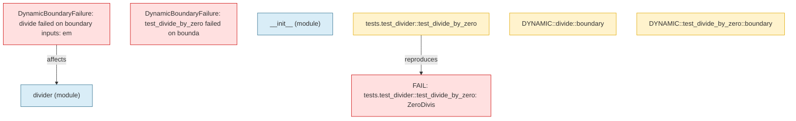

# Autonomous Repository Testing & RCA Report

**Analysis ID:** RUN-80D5AF5AC0  
**Generated:** 1795194025.9184306  
**Final assessment:** NOT READY

## 1. Executive Summary

| Metric | Value |
| --- | --- |
| Overall project health | NOT READY |
| Components analysed | 5 |
| Tests executed | 3 |
| Tests passed | 0 |
| Tests failed/errored | 3 |
| Total issues | 3 |
| Critical issues | 0 |
| High-severity issues | 1 |
| Root causes identified | 3 |
| Confirmed root causes | 3 |
| Analysis capabilities OK / failed | 10 / 0 |

## 2. Repository Analysis

- Project types: unknown
- Languages: Python, JSON
- Frameworks: not detected
- Package managers: not detected
- Test frameworks: pytest
- Entry points: not detected
- External services: not detected
- Database references: not detected
- Files: 4, lines: 23

### Components

| Component | Type | Path | Language |
| --- | --- | --- | --- |
| __init__ | module | src/__init__.py | Python |
| divider | module | src/divider.py | Python |
| divide | function | src/divider.py | Python |
| test_divider | test | tests/test_divider.py | Python |
| test_divide_by_zero | function | tests/test_divider.py | Python |

## 3. Testing Summary

| Test | Component | Status | Error |
| --- | --- | --- | --- |
| tests.test_divider::test_divide_by_zero | tests | FAIL | ZeroDivisionError: division by zero |
| DYNAMIC::divide::boundary | src/divider.py | FAIL | empty_str -> TypeError: unsupported operand type(s) for /: 'str' and 'str'; zero -> ZeroDivisionError: division by zero; empty_list -> TypeError: unsupported op |
| DYNAMIC::test_divide_by_zero::boundary | tests/test_divider.py | FAIL | empty_str -> ZeroDivisionError: division by zero; zero -> ZeroDivisionError: division by zero; negative -> ZeroDivisionError: division by zero; empty_list -> Ze |

## 4. Issue Summary

| ID | Component | Error Type | Severity | Status | Source | Root Cause |
| --- | --- | --- | --- | --- | --- | --- |
| TESTF-60F4CAA204 | tests | FAIL | HIGH | Confirmed | TEST | FAIL |
| DYN-1B01A4BE7E | src/divider.py | DynamicBoundaryFailure | MEDIUM | Confirmed | DYNAMIC | DynamicBoundaryFailure |
| DYN-8E502B1287 | tests/test_divider.py | DynamicBoundaryFailure | MEDIUM | Confirmed | DYNAMIC | DynamicBoundaryFailure |

## 5. Detailed RCA

### RCA-5B458DD5C0 — FAIL in tests: tests.test_divider::test_divide_by_zero: ZeroDivisionError: division by zero
- **Issue ID:** TESTF-60F4CAA204
- **Component:** tests
- **File / line:** tests
- **Error type:** FAIL
- **Severity:** HIGH
- **Confidence:** 0.97 (Confirmed)
- **Verified:** True
- **Symptom:** FAIL at tests: tests.test_divider::test_divide_by_zero: ZeroDivisionError: division by zero
- **Immediate cause:** tests.test_divider::test_divide_by_zero: ZeroDivisionError: division by zero
- **Contributing factors:** Test tests.test_divider::test_divide_by_zero reported FAIL; ZeroDivisionError: division by zero; framework=pytest
- **Root cause:** FAIL in tests: tests.test_divider::test_divide_by_zero: ZeroDivisionError: division by zero
- **Impact:** none recorded
- **Evidence:** EV-E0D66EF41F
- **Expected behaviour:** operation completes without FAIL
- **Observed behaviour:** tests.test_divider::test_divide_by_zero: ZeroDivisionError: division by zero

### RCA-83D198AA24 — DynamicBoundaryFailure in src/divider.py: divide failed on boundary inputs: empty_str -> TypeError: unsupported operand 
- **Issue ID:** DYN-1B01A4BE7E
- **Component:** src/divider.py
- **File / line:** src/divider.py
- **Error type:** DynamicBoundaryFailure
- **Severity:** MEDIUM
- **Confidence:** 0.85 (Confirmed)
- **Verified:** True
- **Symptom:** DynamicBoundaryFailure at src/divider.py: divide failed on boundary inputs: empty_str -> TypeError: unsupported operand type(s) for /: 'str' and 'str'; zero -> ZeroDivisionError: division by zero; empty_list -> TypeError: 
- **Immediate cause:** divide failed on boundary inputs: empty_str -> TypeError: unsupported operand type(s) for /: 'str' and 'str'; zero -> ZeroDivisionError: division by zero; empty_list -> TypeError: unsupported operand type(s) for /:
- **Contributing factors:** Generated probe called divide with 6 boundary inputs; 5 input(s) raised exceptions; Executed in isolated sandbox copy
- **Root cause:** DynamicBoundaryFailure in src/divider.py: divide failed on boundary inputs: empty_str -> TypeError: unsupported operand type(s) for /: 'str' and 'str'; zero -> ZeroDivisionError: division by zero; empty_list -> TypeError: unsupported operand type(s) for /:
- **Impact:** none recorded
- **Evidence:** EV-785CF909D7
- **Expected behaviour:** operation completes without DynamicBoundaryFailure
- **Observed behaviour:** divide failed on boundary inputs: empty_str -> TypeError: unsupported operand type(s) for /: 'str' and 'str'; zero -> ZeroDivisionError: division by zero; empty_list -> TypeError: unsupported operand type(s) for /:

### RCA-E9B1DF1C48 — DynamicBoundaryFailure in tests/test_divider.py: test_divide_by_zero failed on boundary inputs: empty_str -> ZeroDivisio
- **Issue ID:** DYN-8E502B1287
- **Component:** tests/test_divider.py
- **File / line:** tests/test_divider.py
- **Error type:** DynamicBoundaryFailure
- **Severity:** MEDIUM
- **Confidence:** 0.85 (Confirmed)
- **Verified:** True
- **Symptom:** DynamicBoundaryFailure at tests/test_divider.py: test_divide_by_zero failed on boundary inputs: empty_str -> ZeroDivisionError: division by zero; zero -> ZeroDivisionError: division by zero; negative -> ZeroDivisionError: divisio
- **Immediate cause:** test_divide_by_zero failed on boundary inputs: empty_str -> ZeroDivisionError: division by zero; zero -> ZeroDivisionError: division by zero; negative -> ZeroDivisionError: division by zero; empty_list -> ZeroDivisionError: div
- **Contributing factors:** Generated probe called test_divide_by_zero with 6 boundary inputs; 6 input(s) raised exceptions; Executed in isolated sandbox copy
- **Root cause:** DynamicBoundaryFailure in tests/test_divider.py: test_divide_by_zero failed on boundary inputs: empty_str -> ZeroDivisionError: division by zero; zero -> ZeroDivisionError: division by zero; negative -> ZeroDivisionError: division by zero; empty_list -> ZeroDivisionErr
- **Impact:** none recorded
- **Evidence:** EV-2D698A4D80
- **Expected behaviour:** operation completes without DynamicBoundaryFailure
- **Observed behaviour:** test_divide_by_zero failed on boundary inputs: empty_str -> ZeroDivisionError: division by zero; zero -> ZeroDivisionError: division by zero; negative -> ZeroDivisionError: division by zero; empty_list -> ZeroDivisionError: div

## 6. Root Cause Graph

| From | To | Relationship |
| --- | --- | --- |
| TEST-DF1DD4B5BE | TESTF-60F4CAA204 | reproduces |
| DYN-1B01A4BE7E | CMP-59F09E9D1D | affects |

## 7. Missing Test Coverage

- No test observed for module '__init__' (src/__init__.py)

## 8. Recommended Fix Order

### 1. FIX-4CA04D823D (priority 15) — tests
- **Problem:** tests.test_divider::test_divide_by_zero: ZeroDivisionError: division by zero
- **Root cause:** FAIL in tests: tests.test_divider::test_divide_by_zero: ZeroDivisionError: division by zero
- **Affected component:** tests
- **Required change:** Inspect expected vs actual values in tests and correct the failing logic or test expectation.
- **Why it works:** The test is a confirmed, reproducible failure with deterministic evidence.
- **Side effects:** If the test expectation is wrong, update the test rather than production code.
- **Additional changes:** none
- **Verification:** Re-run the original failing test, then related tests.
- **Regression tests:** Full existing test suite, Boundary probes for the affected component
- **Verification result:** SKIPPED — No safe automated patch available; recommendation requires a human-reviewed change. Deterministic hypothesis verification evidence is reported in the RCA chain.
- **Regression result:** Skipped: fix not confirmed or no automatable patch

### 2. FIX-B0BBD8E18B (priority 25) — src/divider.py
- **Problem:** divide failed on boundary inputs: empty_str -> TypeError: unsupported operand type(s) for /: 'str' and 'str'; zero -> ZeroDivisionError: division by zero; empty_list -> TypeError: unsupported operand type(s) for /:
- **Root cause:** DynamicBoundaryFailure in src/divider.py: divide failed on boundary inputs: empty_str -> TypeError: unsupported operand type(s) for /: 'str' and 'str'; zero -> ZeroDivisionError: division by zero; empty_list -> TypeError: unsupported operand type(s) for /:
- **Affected component:** divider.py
- **Required change:** Add input validation/guards in src/divider.py for the failing boundary inputs.
- **Why it works:** The component raises unhandled exceptions for empty/null/negative inputs, which propagates to callers.
- **Side effects:** Stricter validation may reject previously tolerated inputs; document contract changes.
- **Additional changes:** none
- **Verification:** Re-run generated boundary probe and existing tests.
- **Regression tests:** Full existing test suite, Boundary probes for the affected component
- **Verification result:** SKIPPED — No safe automated patch available; recommendation requires a human-reviewed change. Deterministic hypothesis verification evidence is reported in the RCA chain.
- **Regression result:** Skipped: fix not confirmed or no automatable patch

### 3. FIX-EA45099C82 (priority 25) — tests/test_divider.py
- **Problem:** test_divide_by_zero failed on boundary inputs: empty_str -> ZeroDivisionError: division by zero; zero -> ZeroDivisionError: division by zero; negative -> ZeroDivisionError: division by zero; empty_list -> ZeroDivisionError: div
- **Root cause:** DynamicBoundaryFailure in tests/test_divider.py: test_divide_by_zero failed on boundary inputs: empty_str -> ZeroDivisionError: division by zero; zero -> ZeroDivisionError: division by zero; negative -> ZeroDivisionError: division by zero; empty_list -> ZeroDivisionErr
- **Affected component:** test_divider.py
- **Required change:** Add input validation/guards in tests/test_divider.py for the failing boundary inputs.
- **Why it works:** The component raises unhandled exceptions for empty/null/negative inputs, which propagates to callers.
- **Side effects:** Stricter validation may reject previously tolerated inputs; document contract changes.
- **Additional changes:** none
- **Verification:** Re-run generated boundary probe and existing tests.
- **Regression tests:** Full existing test suite, Boundary probes for the affected component
- **Verification result:** SKIPPED — No safe automated patch available; recommendation requires a human-reviewed change. Deterministic hypothesis verification evidence is reported in the RCA chain.
- **Regression result:** Skipped: fix not confirmed or no automatable patch

## 9. Evidence Record

| Finding | Evidence items | Confidence | Status |
| --- | --- | --- | --- |
| tests.test_divider::test_divide_by_zero: ZeroDivisionError: division by zero | Finding TESTF-60F4CAA204 (TEST); Test tests.test_divider::test_divide_by_zero reported FAIL; ZeroDivisionError: division by zero; framework=pytest | 0.97 | Confirmed |
| divide failed on boundary inputs: empty_str -> TypeError: unsupported operand type(s) for  | Finding DYN-1B01A4BE7E (DYNAMIC); Generated probe called divide with 6 boundary inputs; 5 input(s) raised exceptions; Executed in isolated sandbox copy | 0.85 | Confirmed |
| test_divide_by_zero failed on boundary inputs: empty_str -> ZeroDivisionError: division by | Finding DYN-8E502B1287 (DYNAMIC); Generated probe called test_divide_by_zero with 6 boundary inputs; 6 input(s) raised exceptions; Executed in isolated sandbox copy | 0.85 | Confirmed |

## 10. Capability Status

| Capability | Status | Detail |
| --- | --- | --- |
| repository_understanding | OK |  |
| static_analysis | OK |  |
| dependency_analysis | OK |  |
| test_execution | OK |  |
| dynamic_analysis | OK |  |
| evidence_aggregation | OK |  |
| agent_investigation | OK |  |
| rca_and_correlation | OK |  |
| graph_and_fixes | OK |  |
| verification | OK |  |

## 11. Final Assessment

**NOT READY** — 
confirmed failures or high-severity root causes remain unresolved. Apply fixes in priority order and re-run the analysis.

*All code execution was performed in an isolated sandbox copy. Secret-like values are redacted.*
