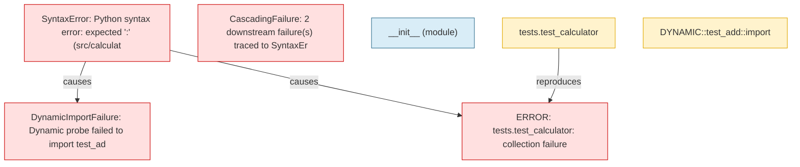

# Autonomous Repository Testing & RCA Report

**Analysis ID:** RUN-4DB8F58542  
**Generated:** 1795194028.2996838  
**Final assessment:** NOT READY

## 1. Executive Summary

| Metric | Value |
| --- | --- |
| Overall project health | NOT READY |
| Components analysed | 3 |
| Tests executed | 2 |
| Tests passed | 0 |
| Tests failed/errored | 2 |
| Total issues | 4 |
| Critical issues | 0 |
| High-severity issues | 4 |
| Root causes identified | 1 |
| Confirmed root causes | 1 |
| Analysis capabilities OK / failed | 10 / 0 |

## 2. Repository Analysis

- Project types: unknown
- Languages: Python, JSON
- Frameworks: not detected
- Package managers: not detected
- Test frameworks: pytest
- Entry points: not detected
- External services: not detected
- Database references: not detected
- Files: 4, lines: 18

### Components

| Component | Type | Path | Language |
| --- | --- | --- | --- |
| __init__ | module | src/__init__.py | Python |
| test_calculator | test | tests/test_calculator.py | Python |
| test_add | function | tests/test_calculator.py | Python |

## 3. Testing Summary

| Test | Component | Status | Error |
| --- | --- | --- | --- |
| tests.test_calculator |  | ERROR | collection failure |
| DYNAMIC::test_add::import | tests/test_calculator.py | ERROR | SyntaxError: expected ':' (calculator.py, line 1) |

## 4. Issue Summary

| ID | Component | Error Type | Severity | Status | Source | Root Cause |
| --- | --- | --- | --- | --- | --- | --- |
| DET-E14A2C6DC0 | src/calculator.py:1 | SyntaxError | HIGH | Confirmed | DETERMINISTIC | SyntaxError |
| TESTF-6F67785405 | tests.test_calculator | ERROR | HIGH | Confirmed | TEST | - |
| DYN-2323A75267 | tests/test_calculator.py | DynamicImportFailure | HIGH | Confirmed | DYNAMIC | - |
| AGT-21140500B4 | src/calculator.py:1 | CascadingFailure | HIGH | Confirmed | AGENT | - |

## 5. Detailed RCA

### RCA-1D8B84EC36 — SyntaxError in src/calculator.py (line 1): Python syntax error: expected ':' (src/calculator.py, line 1)
- **Issue ID:** DET-E14A2C6DC0
- **Component:** src/calculator.py
- **File / line:** src/calculator.py:1
- **Error type:** SyntaxError
- **Severity:** HIGH
- **Confidence:** 0.99 (Confirmed)
- **Verified:** True
- **Symptom:** ERROR at tests.test_calculator: tests.test_calculator: collection failure
- **Immediate cause:** Python syntax error: expected ':' (src/calculator.py, line 1)
- **Contributing factors:** DynamicImportFailure (tests/test_calculator.py): Dynamic probe failed to import test_add: SyntaxError: expected ':' (calculator.py, line 1); ast.parse failed for src/calculator.py; expected ':' (src/calculator.py, line 1)
- **Root cause:** SyntaxError in src/calculator.py (line 1): Python syntax error: expected ':' (src/calculator.py, line 1)
- **Impact:** DynamicImportFailure at tests/test_calculator.py: Dynamic probe failed to import test_add: SyntaxError: expected ':' (calculator.py, line 1); ERROR at tests.test_calculator: tests.test_calculator: collection failure
- **Evidence:** EV-5FDDE59A76, EV-AA25A95FA8, EV-7A603AA65A, EV-1E63F7ECFB, EV-9A949CF2D4
- **Expected behaviour:** operation completes without SyntaxError
- **Observed behaviour:** Python syntax error: expected ':' (src/calculator.py, line 1)

## 6. Root Cause Graph

| From | To | Relationship |
| --- | --- | --- |
| DET-E14A2C6DC0 | DYN-2323A75267 | causes |
| DET-E14A2C6DC0 | TESTF-6F67785405 | causes |
| TEST-97870D1593 | TESTF-6F67785405 | reproduces |

## 7. Missing Test Coverage

- No test observed for module '__init__' (src/__init__.py)

## 8. Recommended Fix Order

### 1. FIX-B38FB081BE (priority 13) — src/calculator.py
- **Problem:** Python syntax error: expected ':' (src/calculator.py, line 1)
- **Root cause:** SyntaxError in src/calculator.py (line 1): Python syntax error: expected ':' (src/calculator.py, line 1)
- **Affected component:** calculator.py
- **Required change:** Correct the syntax error at src/calculator.py:1 indicated by the parser.
- **Why it works:** Python cannot compile the module, so every import/test depending on it fails.
- **Side effects:** Ensure indentation and surrounding code remain consistent.
- **Additional changes:** none
- **Verification:** Run python -m py_compile on the file, then the full test suite.
- **Regression tests:** Syntax compile check, Full test suite
- **Verification result:** SKIPPED — No safe automated patch available; recommendation requires a human-reviewed change. Deterministic hypothesis verification evidence is reported in the RCA chain.
- **Regression result:** Skipped: fix not confirmed or no automatable patch

## 9. Evidence Record

| Finding | Evidence items | Confidence | Status |
| --- | --- | --- | --- |
| Python syntax error: expected ':' (src/calculator.py, line 1) | Finding DET-E14A2C6DC0 (DETERMINISTIC); ast.parse failed for src/calculator.py; expected ':' (src/calculator.py, line 1) | 0.99 | Confirmed |
| tests.test_calculator: collection failure | Finding TESTF-6F67785405 (TEST); Test tests.test_calculator reported ERROR; collection failure; framework=pytest | 0.97 | Confirmed |
| Dynamic probe failed to import test_add: SyntaxError: expected ':' (calculator.py, line 1) | Finding DYN-2323A75267 (DYNAMIC); Generated probe import failed for test_add; SyntaxError: expected ':' (calculator.py, line 1); Executed in isolated sandbox copy | 0.95 | Confirmed |
| SyntaxError at src/calculator.py:1 is a likely root cause: Python syntax error: expected ' | Finding DET-E14A2C6DC0: Python syntax error: expected ':' (src/calculator.py, line 1); ast.parse failed for src/calculator.py; expected ':' (src/calculator.py, line 1); Linked TEST | 0.99 | Confirmed |
| DynamicImportFailure at tests/test_calculator.py is a likely root cause: Dynamic probe fai | Finding DYN-2323A75267: Dynamic probe failed to import test_add: SyntaxError: expected ':' (calculator.py, line 1); Generated probe import failed for test_add; SyntaxError: expecte | 0.95 | Confirmed |

## 10. Capability Status

| Capability | Status | Detail |
| --- | --- | --- |
| repository_understanding | OK |  |
| static_analysis | OK |  |
| dependency_analysis | OK |  |
| test_execution | OK |  |
| dynamic_analysis | OK |  |
| evidence_aggregation | OK |  |
| agent_investigation | OK |  |
| rca_and_correlation | OK |  |
| graph_and_fixes | OK |  |
| verification | OK |  |

## 11. Final Assessment

**NOT READY** — 
confirmed failures or high-severity root causes remain unresolved. Apply fixes in priority order and re-run the analysis.

*All code execution was performed in an isolated sandbox copy. Secret-like values are redacted.*
